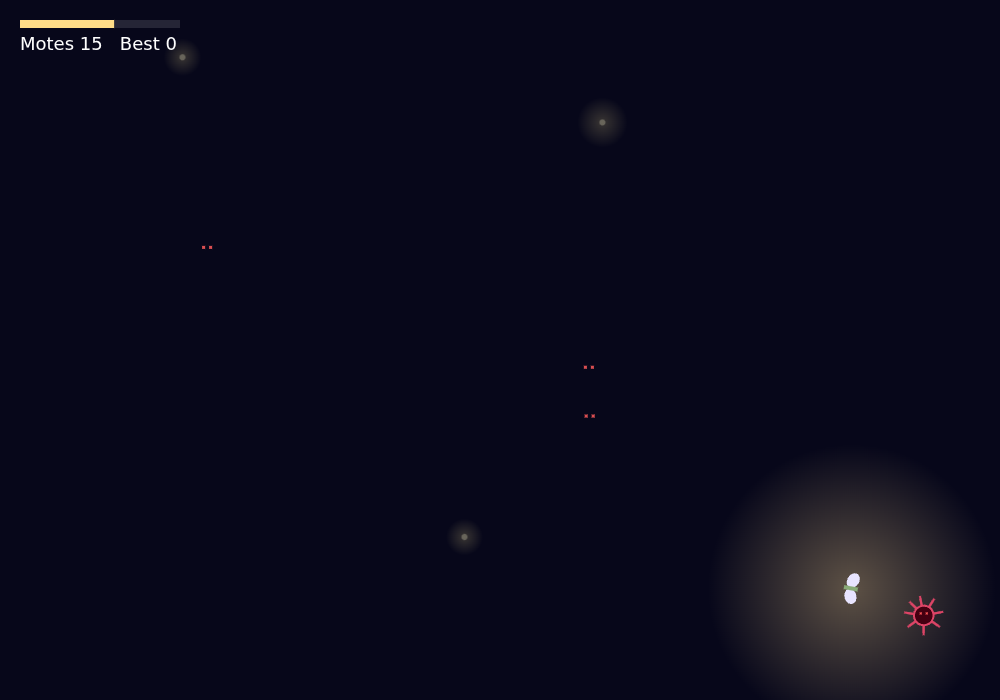

# Glowmoth

A tiny, single-file browser game. You are a moth whose light is fading. Gather glowing motes to refill it, and avoid the spiders, which hunt whatever your light reveals.

**Play:** https://phoenixbycaselka.github.io/glowmoth/

Controls: mouse / touch (move toward pointer), or arrow keys / WASD.

No dependencies, one HTML file, best score stored in localStorage. MIT licensed.

## Tests and known flaws (16 Nov 2026)
- `node test/hz.js`: the game runs at the same speed on 60 Hz and 120 Hz screens (before this fix, 120 Hz screens ran it at double speed).
- `node test/bot.js`: a headless bot play-test. Before 16 Nov the light never mattered: every bot run ended with a spider. Now light drains faster, only 3 motes are out at once, and each mote refills less as the run goes on (+14 down to +7). A cautious bot that flees spiders now loses about half its runs to darkness, yet still lives about twice as long as a greedy one. Fleeing costs light, and that is the trade-off. A greedy bot never starves, because it never stops eating. These are bot numbers. Whether it is *fun* still needs a person.
- Phones (16 Nov): `node test/bot.js 60 390x844`. On a 390 px-wide phone, the fixed 210 px light lit most of the screen, and spiders spawned at the edge reached you in half the time. The cautious bot lived only 58% as long as on desktop, and darkness almost never killed it. Light radius and spider speed now scale with the screen below 700 px: phone survival is 78% of desktop, and a third of phone runs end in darkness, the same share as on desktop. Spider eyes in the dark are a little brighter, because at 2 px they were nearly invisible on a phone.
